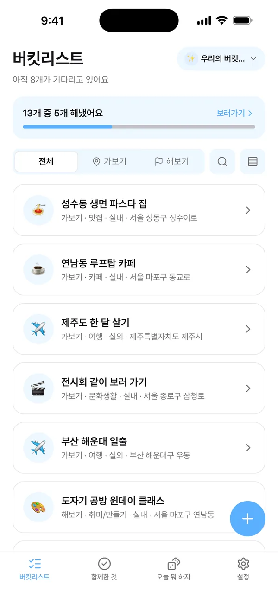
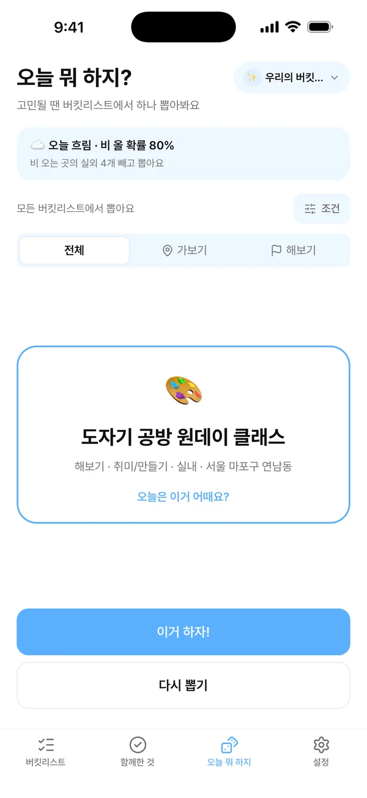
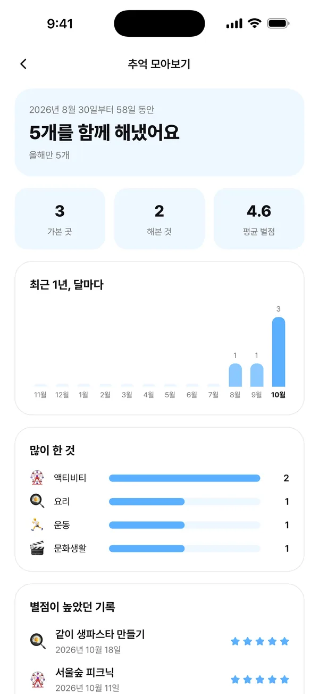

# DoIt2 (두잇투)

연인, 친구, 가족과 함께 쓰는 버킷리스트 + 기록 앱입니다. 가고 싶은 곳과 해보고 싶은 것을 한 공간에 모으고, 다녀온 뒤에는 사진과 별점, 한 줄 후기를 남깁니다.

[App Store](https://apps.apple.com/kr/app/id6826993862) · [소개 사이트](https://doit2app.github.io)

<p>
  
  
  
</p>

Expo SDK 58 · Expo Router · NativeWind v4 · Zustand · Supabase · Jest

## 기능

- **공간**: 초대 코드나 초대 링크로 최대 10명까지 함께 쓴다. 한 사람이 여러 공간에 들어갈 수 있고, 나만 보는 공간도 만들 수 있다.
- **가보기 · 해보기**: 카카오 장소 검색이나 지도에서 장소를 골라 담고, 할 것 체크리스트와 참고 링크를 붙인다.
- **함께한 기록**: 날짜, 사진, 별점, 한 줄 후기. 공간에서는 사람마다 따로 평가하고 댓글과 반응을 남긴다.
- **오늘 뭐 하지?**: 버킷리스트에서 하나를 뽑는다. 비 오는 날에는 실외를 뺀다.
- **목표 날짜**: 날짜를 하루나 기간으로 잡고, 투표하고, 캘린더에 넣고, 그날 날씨 예보를 본다.
- **추억 모아보기**: 다녀온 곳 지도, 달력, 통계, 사진 모음, 한 해 돌아보기 카드.
- **웹 링크로 공유**: 한 해 돌아보기를 고른 사진과 함께 웹 페이지로 나눈다. 30일 뒤 만료된다.
- **그 밖에**: 알림, 휴지통, AI로 항목 채우기(버튼을 눌렀을 때만), 계정 코드로 기기 옮기기.

## 구조

| 위치                              | 내용                                                                                  |
| --------------------------------- | ------------------------------------------------------------------------------------- |
| `app/`                            | 화면 (Expo Router)                                                                    |
| `components/`, `hooks/`, `store/` | 화면 부품, 훅, Zustand 스토어                                                         |
| `lib/`                            | 화면과 떨어진 로직. `lib/bucket`의 계산 로직은 Jest로 테스트한다                      |
| `supabase/migrations/`            | DB 스키마와 RLS 정책, DB 함수 (마이그레이션 41개)                                     |
| `supabase/functions/`             | Edge Function 6개 (카카오 검색 프록시, 링크 미리보기, 알림, AI, 계정 코드, 계정 삭제) |
| `site/`                           | 소개 사이트, 초대 링크 페이지, 돌아보기 공유 페이지, 개인정보처리방침 (정적 HTML)     |
| `__tests__/`                      | Jest 테스트 30개 파일                                                                 |
| `docs/RELEASE.md`                 | 버전 관리와 출시 절차                                                                 |

## 설계에서 신경 쓴 것

- **여러 명이 동시에 고쳐도 유실되지 않는 동기화**: 목록 전체를 덮어쓰지 않고 체크·추가 같은 변경 단위로 기록해 서버의 최신 상태 위에 다시 적용한다. 같은 변경을 두 번 보내도 결과가 같고, 오프라인에서는 쌓아 두었다가 보낸다. (`__tests__/todoOps.test.ts`, `__tests__/outbox.test.ts`)
- **권한은 서버에서**: 모든 표에 RLS를 걸어 공간 멤버만 읽고 쓴다. 공간 참여나 공간장 위임처럼 여러 표를 바꾸는 일은 DB 함수로 묶었고, 초대 코드와 공유 코드는 틀린 횟수를 세어 추측을 막는다.
- **앱 밖의 웹 페이지**: 초대 링크 페이지는 서버에서 공간을 읽지 않고 링크에 실린 이름만 보여 준다(코드만으로 남의 공간 정보를 볼 수 없게). 돌아보기 공유는 맞힐 수 없는 id를 링크로 쓰고, 사진은 원본을 비공개로 둔 채 촬영 위치 정보를 뺀 사본만 공개 버킷에 올린다.
- **업데이트와 오류**: OTA 업데이트, 서버의 최소 버전보다 낮은 앱 막기, 오류를 기기에 먼저 저장했다가 서버로 보내기.

## 개발

1. `.env.example`을 `.env`로 복사하고 Supabase 주소와 공개 키를 채운다.
2. Supabase 대시보드에서 익명 로그인을 켜고, Edge Functions 시크릿에 `KAKAO_REST_API_KEY`를 넣는다.
3. `npx expo start`

```bash
npm test            # Jest
npm run type-check  # tsc
npm run lint
npm run update      # OTA 업데이트 내보내기 (docs/RELEASE.md)
```

데이터베이스 변경(SQL)은 `supabase/migrations`, 서버 함수는 `supabase/functions`에 있다. `site/`는 `doit2app/doit2app.github.io` 저장소에 올려 배포한다.
